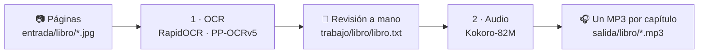

# 🎧 genAudioLibro

**De las fotos de un libro a un audiolibro, todo en local y sin GPU.**

Un pipeline de tres pasos que convierte páginas escaneadas o fotografiadas en un audiolibro en MP3, con un archivo por capítulo. El OCR usa RapidOCR y la voz usa Kokoro-82M, ambos en CPU. El texto no sale del equipo.


---

## ✨ Cómo funciona



1. **OCR.** Lee cada página, guarda la posición y la confianza de cada línea y marca las páginas dudosas.
2. **Texto.** Ordena los fragmentos, quita los números de página y genera `libro.txt`. Ese archivo se **corrige a mano** antes de seguir, porque ningún OCR acierta el 100 % y un error de lectura se oye en el audio.
3. **Audio.** Sintetiza cada párrafo con Kokoro, añade pausas y monta un MP3 por capítulo.

Cada paso se puede repetir sin perder trabajo: si se interrumpe, retoma donde se quedó.

## 🚀 Inicio rápido

Probado en Windows 11 con Python 3.12.

```powershell
git clone https://github.com/ZappaGit/lab-genAudioLibro.git
cd lab-genAudioLibro

python -m venv .venv
.\.venv\Scripts\python.exe -m pip install --upgrade pip
.\.venv\Scripts\python.exe -m pip install torch --index-url https://download.pytorch.org/whl/cpu
.\.venv\Scripts\python.exe -m pip install -r requirements.txt
```

Después, con tu libro:

```powershell
# 1. Copia las fotos a entrada\mi-libro\ (se leen por orden de nombre: 001.jpg, 002.jpg…)
.\.venv\Scripts\python.exe paso1_ocr.py mi-libro

# 2. Genera el texto y revísalo
.\.venv\Scripts\python.exe paso2_texto.py mi-libro
code trabajo\mi-libro\libro.txt

# 3. Genera el audiolibro
.\.venv\Scripts\python.exe paso3_audio.py mi-libro
```

El resultado queda en `salida\mi-libro\`.

> **Nota:** para la voz en español hace falta [espeak-ng](https://github.com/espeak-ng/espeak-ng/releases) instalado en el sistema.

## 🧩 Los tres pasos

| Paso | Script | Entrada | Resultado |
|------|--------|---------|-----------|
| 1. OCR | `paso1_ocr.py` | `entrada/<libro>/*.jpg` | `trabajo/<libro>/ocr/*.json` y `ocr_informe.csv` |
| 2. Texto | `paso2_texto.py` | los JSON del paso 1 | `trabajo/<libro>/libro.txt` |
| 3. Audio | `paso3_audio.py` | `libro.txt` | `salida/<libro>/NN-titulo.mp3` |

Las reejecuciones son seguras:

- El paso 1 salta las páginas que ya tienen JSON (`--forzar` las repite).
- El paso 2 no sobrescribe `libro.txt` si ya existe, para no borrar tus correcciones (`--forzar` lo regenera).
- El paso 3 guarda el audio de cada párrafo en `trabajo/<libro>/audio/`. Cada archivo lleva un hash del texto y de la voz, así que corregir una frase solo regenera ese párrafo. Cambiar la voz o la velocidad obliga a sintetizar todo de nuevo.

### Formato de `libro.txt`

- Un párrafo por bloque, separados por una línea en blanco.
- Una línea que empieza por `# ` es un título de capítulo: se lee en voz alta y abre un MP3 nuevo.
- Los títulos se detectan solos si empiezan por *Capítulo, Parte, Prólogo, Epílogo, Introducción o Prefacio* (`PATRON_CAPITULO` en `config.py`).

### Qué revisar antes del paso 3

- **`ocr_informe.csv`**: las páginas con estado `revisar` tienen una confianza media baja.
- **Cabeceras repetidas** (título del libro en cada página): ajusta `MARGEN_SUPERIOR` en `config.py` y repite el paso 1 con `--forzar`.
- **Notas al pie, pies de foto y tablas**: se leen como texto normal. Bórralos de `libro.txt` si no deben oírse.
- **Libro abierto con dos páginas por foto**: pon `PAGINAS_DOBLES = True`.

## ⚙️ Configuración

Todos los parámetros están en [`config.py`](config.py), con comentarios en español:

| Parámetro | Valor por defecto | Para qué sirve |
|-----------|-------------------|----------------|
| `VOZ` | `ef_dora` | Voz de Kokoro (`ef_dora`, `em_alex`, `em_santa`; admite mezclas como `"ef_dora,em_alex"`) |
| `IDIOMA_VOZ` | `e` | Idioma de Kokoro (`e` español, `a` inglés EE. UU.) |
| `VELOCIDAD` | `1.0` | 0.8 más lento, 1.2 más rápido |
| `PAUSA_PARRAFO` / `PAUSA_TITULO` | `0.6` / `1.2` s | Silencios entre párrafos y después de un título |
| `FORMATO_SALIDA` | `MP3` | También `FLAC` o `WAV` |
| `PAGINAS_DOBLES` | `False` | Divide cada foto en dos páginas |
| `CONFIANZA_AVISO` | `0.90` | Umbral de aviso en el informe de revisión del OCR |

## 📊 Resultados de la prueba

Prueba sintética de principio a fin: dos páginas con texto inventado, una escaneada limpia y otra que imita una foto (fondo gris, giro de 1,2°, JPEG). Ejecutada sin GPU: Windows 11, Python 3.12.10, 15,7 GB de RAM, Intel UHD, todo en CPU.

| Medida | Valor |
|--------|-------|
| OCR (RapidOCR, modelos ya descargados) | 4,9 s y 4,2 s por página |
| Confianza media del OCR | 0,99 en las dos páginas |
| Texto obtenido frente al esperado | **idéntico** (863 caracteres, 4 párrafos, 1 título) |
| Carga de Kokoro | 8,3 s |
| Síntesis | 27,0 s para 50,9 s de voz (**RTF 0,53**) |
| Archivo final | 54,5 s con pausas, 358 KB, 24 kHz mono |

**Estimación para un libro de 300 páginas** *(estimación: extrapolación lineal de la prueba)*: unos 25 min de OCR y unas 5 horas de síntesis para ~9 horas de audio. Como el paso 3 retoma donde se quedó, el trabajo se puede repartir en varias sesiones.

Para repetir la prueba:

```powershell
.\.venv\Scripts\python.exe prueba_generar_paginas.py
.\.venv\Scripts\python.exe paso1_ocr.py prueba
.\.venv\Scripts\python.exe paso2_texto.py prueba
.\.venv\Scripts\python.exe paso3_audio.py prueba
```

`prueba_generar_paginas.py` deja el texto de referencia en `trabajo/prueba/esperado.txt`, para comparar con el resultado del OCR.

> El audio de la prueba no ha sido valorado de oído todavía: la calidad de la voz y de las pausas está pendiente.

## 🧪 Decisiones técnicas

- **RapidOCR en lugar de EasyOCR.** Con el mismo español, EasyOCR leía `—` como `~`, `¿Qué` como `cQué` y `«…»` como `<…)`, y tardaba unas cuatro veces más por página (20,8 s y 17,1 s). RapidOCR (modelo PP-OCRv5 sobre ONNX Runtime) leyó las dos páginas sin esos errores y se instala solo con pip.
- **Sin LLM para corregir el OCR.** Un modelo pequeño puede cambiar palabras correctas o inventar texto, y el error no se notaría hasta oírlo. La corrección se hace a mano sobre `libro.txt`.
- **Sin ffmpeg.** El MP3 lo escribe `soundfile` (libsndfile). Hay un archivo por capítulo; no se genera un M4B con capítulos.

## ⚠️ Límites conocidos

- **La prueba es sintética.** Demuestra que el proceso funciona de principio a fin, no la calidad con un libro real (papel curvado, sombras, tipografías antiguas). Eso está pendiente.
- **Una sola columna.** El orden de lectura va de arriba abajo; un texto a dos columnas saldría mezclado.
- **Sin evaluación objetiva de la voz.** Las pausas y la naturalidad se valoran a oído.

## 📚 Créditos

- [Kokoro-82M](https://huggingface.co/hexgrad/Kokoro-82M) (Apache 2.0): síntesis de voz.
- [RapidOCR](https://github.com/RapidAI/RapidOCR) con el modelo [PP-OCRv5](https://github.com/PaddlePaddle/PaddleOCR): OCR.
- Creado dentro de la serie [IA 365 modelos](https://github.com/ZappaGit/catalogo_ia_agentica), donde se documentan modelos de IA generativa.

## ⚖️ Derechos de autor

Usa este lab solo con libros propios, de dominio público o con un uso personal permitido. Las carpetas `entrada/`, `trabajo/` y `salida/` no se suben al repositorio.

## Licencia

[MIT](LICENSE)
