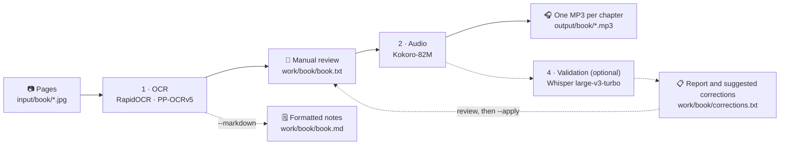

# 🎧 fromBookToAudio

**From the photos of a book to an audiobook, fully local and CPU-only.**

A three-step pipeline that turns scanned or photographed book pages into an audiobook in MP3, one file per chapter. OCR runs with RapidOCR and speech with Kokoro-82M, both on CPU. The text never leaves your machine.


---

## ✨ How it works



1. **OCR.** Reads each page, keeps the position and confidence of every line, and flags doubtful pages.
2. **Text.** Orders the fragments, removes page numbers and builds `book.txt`. You **correct this file by hand** before going on, because no OCR is 100 % accurate and a misread word is heard in the audio. With `--markdown` it also writes `book.md`, which keeps the format of the page: headings, bullet lists and bold words.
3. **Audio.** Synthesizes each paragraph with Kokoro, adds pauses and assembles one MP3 per chapter.
4. **Validation (optional).** Whisper listens to the audio of each paragraph, and what it heard is compared word by word with `book.txt`. Paragraphs that differ too much are flagged for review.

Every step can be re-run without losing work: if it is interrupted, it picks up where it stopped.

## 🚀 Quick start

Tested on Windows 11 with Python 3.12.

```powershell
git clone https://github.com/ZappaGit/fromBookToAudio.git
cd fromBookToAudio

python -m venv .venv
.\.venv\Scripts\python.exe -m pip install --upgrade pip
.\.venv\Scripts\python.exe -m pip install torch --index-url https://download.pytorch.org/whl/cpu
.\.venv\Scripts\python.exe -m pip install -r requirements.txt
```

Then, with your book:

```powershell
# 1. Copy the photos to input\my-book\ (read in file-name order: 001.jpg, 002.jpg…)
.\.venv\Scripts\python.exe code\step1_ocr.py my-book

# 2. Generate the text and review it
.\.venv\Scripts\python.exe code\step2_text.py my-book          # add --markdown to also get book.md
code work\my-book\book.txt

# 3. Generate the audiobook
.\.venv\Scripts\python.exe code\step3_audio.py my-book

# 4. Optional: let Whisper listen to the audio and compare it with the text
.\.venv\Scripts\python.exe code\step4_validate.py my-book
```

The result is in `output\my-book\`.

Or run all three steps with one command (`--validate` adds step 4):

```powershell
.\.venv\Scripts\python.exe code\run.py my-book [--force] [--validate] [--markdown] [--per-image]
```

It stops at the first failing step with the reason and a hint (exit code 1 to 4 = failed step).
Re-running continues where it stopped. An existing `book.txt` is kept, so your corrections are
safe; `--force` redoes the OCR and rebuilds `book.txt` from scratch.

### Or use the window

Double-click **`fromBookToAudio.bat`** in the project root (or make a desktop shortcut to it). A window opens where you can:

- pick a book from `input/`, or **add images from any folder** (they are copied to `input/<name>/`);
- set the voice, language, speed, audio format, rotation, crop, margins, two pages per image, `book.md` and one document per image. These settings are saved in the book's `input/<book>/book.ini`, so the console commands use them too;
- run everything or a single step (with *Force* and *Validate* options), stop it, and see the output;
- open `book.txt`, `corrections.txt` and the input, work and audiobook folders, and apply reviewed corrections.

The window only runs the same scripts as the console, so you can switch between them at any time.

> **Note:** the Spanish voice needs [espeak-ng](https://github.com/espeak-ng/espeak-ng/releases) installed on the system.

## 📁 Project layout

```
fromBookToAudio/
├── code/                  all Python code
│   ├── run.py             runs steps 1 → 2 → 3 with one command
│   ├── launcher.py        the window opened by fromBookToAudio.bat
│   ├── step1_ocr.py
│   ├── step2_text.py
│   ├── step3_audio.py
│   ├── step4_validate.py  optional: checks the audio against the text
│   ├── config.py          all settings
│   └── test_generate_pages.py
├── fromBookToAudio.bat    double-click to open the window
├── input/<book>/          your photos or scans (not committed)
├── work/<book>/           OCR results, book.txt, audio cache (not committed)
└── output/<book>/         the finished MP3s (not committed)
```

`input/`, `work/` and `output/` always live at the project root, whatever folder you run the commands from.

## 🧩 The steps

| Step | Script | Input | Output |
|------|--------|-------|--------|
| 1. OCR | `code/step1_ocr.py` | `input/<book>/*.jpg` | `work/<book>/ocr/*.json` and `ocr_report.csv` |
| 2. Text | `code/step2_text.py` | the JSON files from step 1 | `work/<book>/book.txt`, and `work/<book>/book.md` with `--markdown` |
| 3. Audio | `code/step3_audio.py` | `book.txt` | `output/<book>/NN-title.mp3` |
| 4. Validation (optional) | `code/step4_validate.py` | `book.txt` and `work/<book>/audio/*.flac` | `work/<book>/validation_report.csv`, `work/<book>/corrections.txt` |

Re-running is safe:

- Step 1 skips pages that already have JSON (`--force` redoes them).
- Step 2 never overwrites an existing `book.txt` or `book.md`, so your corrections survive (`--force` regenerates them).
- Step 3 saves the audio of each paragraph in `work/<book>/audio/`, named after a hash of the text and voice settings. Fixing one sentence only regenerates that paragraph. Changing the voice or speed regenerates everything.

- Step 4 saves what Whisper heard for each paragraph in `work/<book>/heard/`, so only new or changed paragraphs are listened to again (`--force` listens to everything again).

### Reading the validation report

`validation_report.csv` has one row per text block with its `similarity` (0 to 1, share of matching words, ignoring case, accents and punctuation), a `status` (`review` below `MIN_SIMILARITY`), the `differences` as `written -> heard`, and both full texts. A difference is a hint, not a verdict: it can be a synthesis problem (cut-off audio, a garbled word) or Whisper's own mistake. Numbers are the usual false alarm, because Whisper writes `12` where the book says `doce`. Listen to the flagged paragraphs before changing anything.

### Improving the text from what was heard

Step 4 also writes `work/<book>/corrections.txt`, one line per difference:

```text
[2] Llevabadoce => Llevaba doce
[3] linterma => linterna
[5] no le gstaba => no le gestaba
```

The number is the text block, the left side is what `book.txt` says and the right side is what Whisper heard. Most lines point at a real OCR error (glued or split words, a missing letter), because Whisper writes the word it recognises, correctly spelled. But the right side is only a suggestion: in the third line above the book says *gustaba*, not *gestaba*. So:

1. Open `corrections.txt`, delete the lines that are wrong and fix the right side where needed. Differences that are only numbers written as digits are left out for you.
2. Run `step4_validate.py <book> --apply`. It writes the remaining lines into `book.txt` (the previous text is kept as `book.before_corrections.txt`) and renames the file to `corrections.applied.txt`.
3. Run step 3 again: only the corrected paragraphs get new audio, and the MP3 files are rebuilt.
4. Run step 4 again to check the result: only the new audio is listened to.

`corrections.txt` is rebuilt on every validation run, so apply your reviewed file before validating again.

### Keeping the format of the page: `book.md`

For pages with a layout worth keeping (school notes, worksheets, summaries), run step 2 with `--markdown`, or set `MARKDOWN = True` in the book's `book.ini`. Besides `book.txt` it writes `work/<book>/book.md`:

```markdown
# EL CICLO DEL AGUA

## ¿Qué es la evaporación?

El sol calienta el mar y el agua se convierte en **vapor**, que sube al cielo.

### Las nubes

El vapor se enfría y forma **nubes**.

## Las fases del ciclo

- La **condensación**. El vapor se convierte en gotas de agua.
```

- **Headings**: a short line set apart from the text, or taller than it. The main title (much taller) gets `#`, section headings `##`, and the headings of boxes that sit side by side `###`.
- **Lists**: lines that start with a bullet mark become `- ` items; the mark is dropped from `book.txt`.
- **Boxes side by side**: step 1 finds the empty strips between them and reads each box top to bottom instead of across. This also fixes `book.txt` and the audio for those pages.
- **Bold words** are a guess from how thick the letters are in the photo. Expect a few wrong ones, above all in small print and under a marker pen that covers the words. Check them.

`book.md` is built from the OCR, not from `book.txt`: a correction made in one file is not in the other. The audio is always made from `book.txt`. Pages processed by step 1 before this feature existed need `step1_ocr.py <book> --force` first, so the layout is recorded.

### One audio and one text per image: `PER_IMAGE`

When every photo is a document of its own (a worksheet, a summary sheet, a letter) rather than a page of one long text, set `PER_IMAGE = True` in the book's `book.ini`, or add `--per-image` to steps 2 and 3 (and to `run.py`). Then:

- step 2 makes each image a chapter of `book.txt`, titled with the headings it starts with (`# EL CICLO DEL AGUA. LA EVAPORACIÓN`), and never joins text across two images;
- step 3 writes, for each image, the audio and its text side by side:

```text
output/my-notes/
  01-el-ciclo-del-agua-la-evaporacion.mp3   .txt   .md
  02-el-ciclo-del-agua-la-lluvia.mp3        .txt   .md
```

The `.txt` comes from `book.txt` (with your corrections); the `.md` comes from `book.md`, so it is only written when step 2 ran with `--markdown`. An image that starts with plain text is titled after its file name. The setting in `book.ini` is the safer way: every step then agrees on it.

```powershell
.\.venv\Scripts\python.exe code\step1_ocr.py my-notes
.\.venv\Scripts\python.exe code\step2_text.py my-notes --markdown --per-image
# correct work\my-notes\book.txt and book.md here
.\.venv\Scripts\python.exe code\step3_audio.py my-notes --per-image
```

### Format of `book.txt`

- One paragraph per block, separated by a blank line.
- A line starting with `# ` is a chapter title: it is read aloud and starts a new MP3.
- Lines starting with *Chapter, Part, Prologue, Epilogue, Introduction or Preface* (Spanish equivalents included) are detected as titles automatically (`CHAPTER_PATTERN` in `code/config.py`).

### What to check before step 3

- **`ocr_report.csv`**: pages marked `review` have a low mean confidence.
- **Repeated headers** (book title on every page): set `MARGIN_TOP` in `code/config.py` and re-run step 1 with `--force`.
- **Footnotes, captions and tables** are read as normal text. Delete them from `book.txt` if they should not be heard.
- **Open book photographed as one image**: set `DOUBLE_PAGES = True`.
- **Pages that come out sideways** (scans or photos without orientation data): set `ROTATE` to 90, 180 or 270 and re-run step 1 with `--force`.
- **Fingers, desk or scanner borders around the page**: cut them off with `CROP`, e.g. `(0.05, 0.0, 0.05, 0.10)` for left, top, right, bottom.

## ⚙️ Configuration

All settings live in [`code/config.py`](code/config.py), with comments:

| Setting | Default | Purpose |
|---------|---------|---------|
| `VOICE` | `ef_dora` | Kokoro voice (`ef_dora`, `em_alex`, `em_santa`; mixes like `"ef_dora,em_alex"` are allowed) |
| `VOICE_LANG` | `e` | Kokoro language (`e` Spanish, `a` US English) |
| `SPEED` | `1.0` | 0.8 slower, 1.2 faster |
| `PAUSE_PARAGRAPH` / `PAUSE_TITLE` | `0.6` / `1.2` s | Silence between paragraphs and after a title |
| `OUTPUT_FORMAT` | `MP3` | Also `FLAC` or `WAV` |
| `PER_IMAGE` | `False` | `True` makes every image its own document: one audio file per image with its `.txt` and `.md` beside it |
| `MARKDOWN` | `False` | `True` makes step 2 also write `book.md` with headings, lists and bold words |
| `ROTATE` | `0` | Turns every image 90, 180 or 270 degrees clockwise before OCR |
| `CROP` | `(0, 0, 0, 0)` | Fraction cut off each edge (left, top, right, bottom) before OCR |
| `DOUBLE_PAGES` | `False` | Splits each photo of an open book into two pages, at the gap between them (photos need not be centred) |
| `REVIEW_CONFIDENCE` | `0.90` | Threshold for flagging pages in the OCR report |
| `MIN_SIMILARITY` | `0.90` | Threshold for flagging text blocks in the validation report |
| `WHISPER_LANGUAGE` | `None` | Language Whisper listens for; `None` takes it from `VOICE_LANG` |

### Settings for one book

Books photographed differently need different settings. Put a `book.ini` next to the images,
in `input/<book>/`, with any setting from `config.py`, written the same way:

```ini
# input/my-book/book.ini — photos of an open book, taken sideways
ROTATE = 270
DOUBLE_PAGES = True
```

These values override `config.py` for that book only, in every step. If you change step 1
settings, re-run with `--force`.

Text that lies beside the page's text block, such as another book or object in the photo, is
ignored automatically.

## 📊 Test results

End-to-end test with two invented pages: one clean scan and one that imitates a photo (grey background, 1.2° rotation, JPEG). Run without a GPU: Windows 11, Python 3.12.10, 15.7 GB RAM, Intel UHD, everything on CPU.

| Measure | Value |
|---------|-------|
| OCR (RapidOCR, models already downloaded) | 4.9 s and 4.2 s per page |
| Mean OCR confidence | 0.99 on both pages |
| Text obtained vs. expected | **identical** (863 characters, 4 paragraphs, 1 title) |
| Kokoro load time | 8.3 s |
| Synthesis | 27.0 s for 50.9 s of speech (**RTF 0.53**) |
| Final file | 54.5 s with pauses, 358 KB, 24 kHz mono |
| Validation (Whisper large-v3-turbo, model already downloaded) | 108.1 s for 50.9 s of speech (**RTF 2.12**), 6.3 s to load |
| Heard vs. written | mean similarity **0.988**, 0 of 5 blocks flagged; differences: `doce -> 12`, `ciento cuarenta -> 140`, `despacio -> de espacio` |

**Estimate for a 300-page book** *(estimate: linear extrapolation from the test)*: about 25 min of OCR and about 5 hours of synthesis for roughly 9 hours of audio. Because step 3 resumes where it stopped, the work can be split across several sessions.

To run the test yourself:

```powershell
.\.venv\Scripts\python.exe code\test_generate_pages.py
.\.venv\Scripts\python.exe code\step1_ocr.py test
.\.venv\Scripts\python.exe code\step2_text.py test
.\.venv\Scripts\python.exe code\step3_audio.py test
.\.venv\Scripts\python.exe code\step4_validate.py test
```

`code/test_generate_pages.py` writes the reference text to `work/test/expected.txt`, so you can compare it with the OCR result. The test text is in Spanish because the default voice is Spanish.

> The audio of the test has not been evaluated by ear yet: voice quality and pauses are pending.

## 🧪 Technical decisions

- **RapidOCR instead of EasyOCR.** On the same Spanish pages, EasyOCR read `—` as `~`, `¿Qué` as `cQué` and `«…»` as `<…)`, and it was about four times slower (20.8 s and 17.1 s per page). RapidOCR (PP-OCRv5 model on ONNX Runtime) read both pages without those errors and installs with pip alone.
- **No LLM to correct the OCR.** A small model can change correct words or invent text, and the error would go unnoticed until heard. Corrections are made by hand in `book.txt`.
- **Whisper as a second pair of ears, not as an editor.** Step 4 reports where the audio and the text disagree and proposes corrections, but it never changes `book.txt` on its own, because Whisper can also mishear or invent text: corrections are written only with `--apply`, after you have reviewed them. It checks each paragraph's cached audio rather than the finished MP3, so a difference points to one paragraph. The price is speed: Whisper always processes a 30-second window, so short paragraphs cost as much as long ones (about twice the length of the audio in the test).
- **No ffmpeg.** The MP3 is written by `soundfile` (libsndfile). There is one file per chapter; chapter-marked M4B is not generated.

## ⚠️ Known limits

- **The test is synthetic.** It proves the pipeline works end to end, not the quality on a real book (curled pages, shadows, old typefaces). That is still to be tested.
- **Simple layouts only.** Reading order runs top to bottom. Boxes that sit side by side with a clear gap between them are read one after another, but a page set in two tight columns, or text that wraps around a picture, can still come out mixed.
- **`book.md` is an approximation.** Headings, lists and bold words are worked out from positions and letter thickness, not read from the page, so they need a look. Colours, underlines, marker pen and pictures are not kept.
- **No objective voice evaluation.** Pauses and naturalness are judged by ear. Step 4 checks that the words are there, not how they sound.
- **Validation only catches OCR errors that break a word.** A glued, split or misspelled word is read oddly and Whisper writes it properly, so it shows up. An OCR error that is itself a real word (`casa` read as `cosa`) is read aloud, heard back and counted as correct.

## 📚 Credits

- [Kokoro-82M](https://huggingface.co/hexgrad/Kokoro-82M) (Apache 2.0): speech synthesis.
- [Whisper large-v3-turbo](https://huggingface.co/openai/whisper-large-v3-turbo) (MIT): speech recognition for the validation step.
- [RapidOCR](https://github.com/RapidAI/RapidOCR) with the [PP-OCRv5](https://github.com/PaddlePaddle/PaddleOCR) model: OCR.
- Built as part of the [IA 365 modelos](https://github.com/ZappaGit/catalogo_ia_agentica) series, which documents generative AI models.

## ⚖️ Copyright

Use this lab only with books you own, public-domain books, or for permitted personal use. The `input/`, `work/` and `output/` folders are not committed to the repository.

## License

[MIT](LICENSE)
