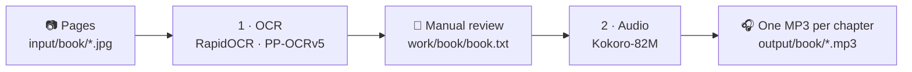

# 🎧 fromBookToAudio

**From the photos of a book to an audiobook, fully local and CPU-only.**

A three-step pipeline that turns scanned or photographed book pages into an audiobook in MP3, one file per chapter. OCR runs with RapidOCR and speech with Kokoro-82M, both on CPU. The text never leaves your machine.


---

## ✨ How it works



1. **OCR.** Reads each page, keeps the position and confidence of every line, and flags doubtful pages.
2. **Text.** Orders the fragments, removes page numbers and builds `book.txt`. You **correct this file by hand** before going on, because no OCR is 100 % accurate and a misread word is heard in the audio.
3. **Audio.** Synthesizes each paragraph with Kokoro, adds pauses and assembles one MP3 per chapter.

Every step can be re-run without losing work: if it is interrupted, it picks up where it stopped.

## 🚀 Quick start

Tested on Windows 11 with Python 3.12.

```powershell
git clone https://github.com/ZappaGit/fromBookToAudio.git
cd fromBookToAudio

python -m venv .venv
.\.venv\Scripts\python.exe -m pip install --upgrade pip
.\.venv\Scripts\python.exe -m pip install torch --index-url https://download.pytorch.org/whl/cpu
.\.venv\Scripts\python.exe -m pip install -r requirements.txt
```

Then, with your book:

```powershell
# 1. Copy the photos to input\my-book\ (read in file-name order: 001.jpg, 002.jpg…)
.\.venv\Scripts\python.exe step1_ocr.py my-book

# 2. Generate the text and review it
.\.venv\Scripts\python.exe step2_text.py my-book
code work\my-book\book.txt

# 3. Generate the audiobook
.\.venv\Scripts\python.exe step3_audio.py my-book
```

The result is in `output\my-book\`.

> **Note:** the Spanish voice needs [espeak-ng](https://github.com/espeak-ng/espeak-ng/releases) installed on the system.

## 🧩 The three steps

| Step | Script | Input | Output |
|------|--------|-------|--------|
| 1. OCR | `step1_ocr.py` | `input/<book>/*.jpg` | `work/<book>/ocr/*.json` and `ocr_report.csv` |
| 2. Text | `step2_text.py` | the JSON files from step 1 | `work/<book>/book.txt` |
| 3. Audio | `step3_audio.py` | `book.txt` | `output/<book>/NN-title.mp3` |

Re-running is safe:

- Step 1 skips pages that already have JSON (`--force` redoes them).
- Step 2 never overwrites an existing `book.txt`, so your corrections survive (`--force` regenerates it).
- Step 3 saves the audio of each paragraph in `work/<book>/audio/`, named after a hash of the text and voice settings. Fixing one sentence only regenerates that paragraph. Changing the voice or speed regenerates everything.

### Format of `book.txt`

- One paragraph per block, separated by a blank line.
- A line starting with `# ` is a chapter title: it is read aloud and starts a new MP3.
- Lines starting with *Chapter, Part, Prologue, Epilogue, Introduction or Preface* (Spanish equivalents included) are detected as titles automatically (`CHAPTER_PATTERN` in `config.py`).

### What to check before step 3

- **`ocr_report.csv`**: pages marked `review` have a low mean confidence.
- **Repeated headers** (book title on every page): set `MARGIN_TOP` in `config.py` and re-run step 1 with `--force`.
- **Footnotes, captions and tables** are read as normal text. Delete them from `book.txt` if they should not be heard.
- **Open book photographed as one image**: set `DOUBLE_PAGES = True`.
- **Pages that come out sideways** (scans or photos without orientation data): set `ROTATE` to 90, 180 or 270 and re-run step 1 with `--force`.
- **Fingers, desk or scanner borders around the page**: cut them off with `CROP`, e.g. `(0.05, 0.0, 0.05, 0.10)` for left, top, right, bottom.

## ⚙️ Configuration

All settings live in [`config.py`](config.py), with comments:

| Setting | Default | Purpose |
|---------|---------|---------|
| `VOICE` | `ef_dora` | Kokoro voice (`ef_dora`, `em_alex`, `em_santa`; mixes like `"ef_dora,em_alex"` are allowed) |
| `VOICE_LANG` | `e` | Kokoro language (`e` Spanish, `a` US English) |
| `SPEED` | `1.0` | 0.8 slower, 1.2 faster |
| `PAUSE_PARAGRAPH` / `PAUSE_TITLE` | `0.6` / `1.2` s | Silence between paragraphs and after a title |
| `OUTPUT_FORMAT` | `MP3` | Also `FLAC` or `WAV` |
| `ROTATE` | `0` | Turns every image 90, 180 or 270 degrees clockwise before OCR |
| `CROP` | `(0, 0, 0, 0)` | Fraction cut off each edge (left, top, right, bottom) before OCR |
| `DOUBLE_PAGES` | `False` | Splits each photo into two pages |
| `REVIEW_CONFIDENCE` | `0.90` | Threshold for flagging pages in the OCR report |

## 📊 Test results

End-to-end test with two invented pages: one clean scan and one that imitates a photo (grey background, 1.2° rotation, JPEG). Run without a GPU: Windows 11, Python 3.12.10, 15.7 GB RAM, Intel UHD, everything on CPU.

| Measure | Value |
|---------|-------|
| OCR (RapidOCR, models already downloaded) | 4.9 s and 4.2 s per page |
| Mean OCR confidence | 0.99 on both pages |
| Text obtained vs. expected | **identical** (863 characters, 4 paragraphs, 1 title) |
| Kokoro load time | 8.3 s |
| Synthesis | 27.0 s for 50.9 s of speech (**RTF 0.53**) |
| Final file | 54.5 s with pauses, 358 KB, 24 kHz mono |

**Estimate for a 300-page book** *(estimate: linear extrapolation from the test)*: about 25 min of OCR and about 5 hours of synthesis for roughly 9 hours of audio. Because step 3 resumes where it stopped, the work can be split across several sessions.

To run the test yourself:

```powershell
.\.venv\Scripts\python.exe test_generate_pages.py
.\.venv\Scripts\python.exe step1_ocr.py test
.\.venv\Scripts\python.exe step2_text.py test
.\.venv\Scripts\python.exe step3_audio.py test
```

`test_generate_pages.py` writes the reference text to `work/test/expected.txt`, so you can compare it with the OCR result. The test text is in Spanish because the default voice is Spanish.

> The audio of the test has not been evaluated by ear yet: voice quality and pauses are pending.

## 🧪 Technical decisions

- **RapidOCR instead of EasyOCR.** On the same Spanish pages, EasyOCR read `—` as `~`, `¿Qué` as `cQué` and `«…»` as `<…)`, and it was about four times slower (20.8 s and 17.1 s per page). RapidOCR (PP-OCRv5 model on ONNX Runtime) read both pages without those errors and installs with pip alone.
- **No LLM to correct the OCR.** A small model can change correct words or invent text, and the error would go unnoticed until heard. Corrections are made by hand in `book.txt`.
- **No ffmpeg.** The MP3 is written by `soundfile` (libsndfile). There is one file per chapter; chapter-marked M4B is not generated.

## ⚠️ Known limits

- **The test is synthetic.** It proves the pipeline works end to end, not the quality on a real book (curled pages, shadows, old typefaces). That is still to be tested.
- **Single column only.** Reading order runs top to bottom; two-column text would come out mixed.
- **No objective voice evaluation.** Pauses and naturalness are judged by ear.

## 📚 Credits

- [Kokoro-82M](https://huggingface.co/hexgrad/Kokoro-82M) (Apache 2.0): speech synthesis.
- [RapidOCR](https://github.com/RapidAI/RapidOCR) with the [PP-OCRv5](https://github.com/PaddlePaddle/PaddleOCR) model: OCR.
- Built as part of the [IA 365 modelos](https://github.com/ZappaGit/catalogo_ia_agentica) series, which documents generative AI models.

## ⚖️ Copyright

Use this lab only with books you own, public-domain books, or for permitted personal use. The `input/`, `work/` and `output/` folders are not committed to the repository.

## License

[MIT](LICENSE)
